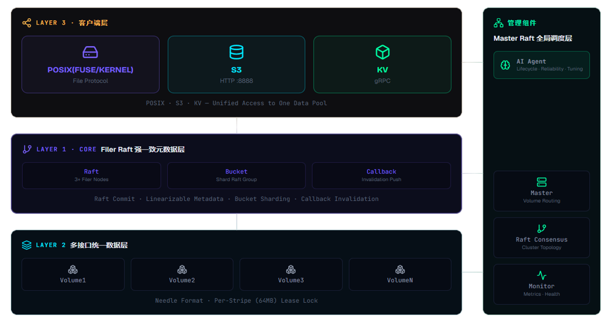
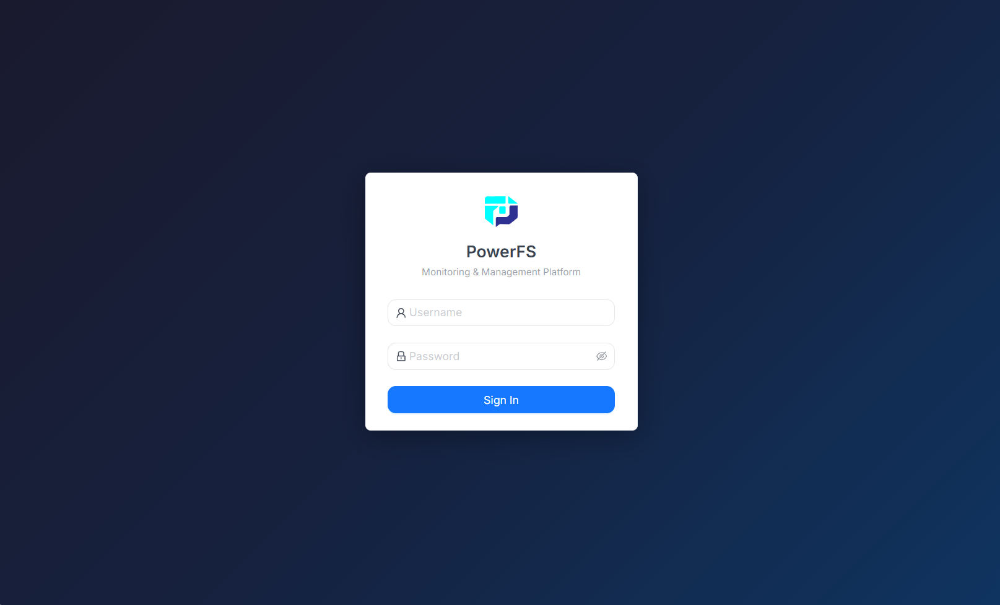
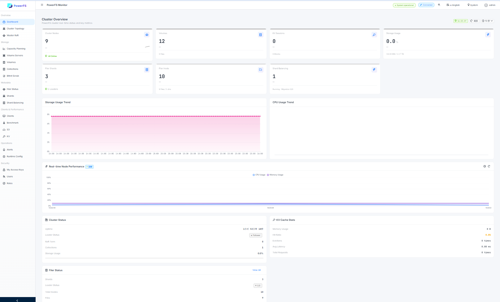
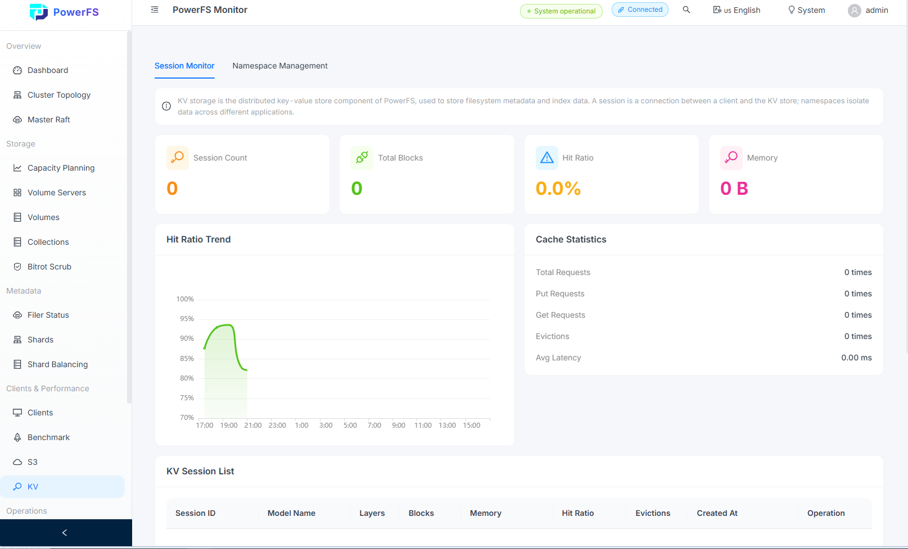

# PowerFS

**One storage for HPC + AI. Rust-native. Zero jitter.**

Unified POSIX / S3 / KV cache in a single cluster — eliminating the three-stack fragmentation that plagues HPC+AI converged infrastructure.

[Why PowerFS](#why-powerfs) • [Architecture](#architecture) • [Key Features](#key-features) • [Roadmap](#-roadmap) • [Scenarios](#application-scenarios) • [Benchmark](#benchmark) • [Prerequisites](#prerequisites) • [Quick Start](#quick-start) • [Articles](articles/) • [License](#license)

---

## Why PowerFS?

| The Problem | The PowerFS Solution |
|---|---|
| HPC storage (Lustre/BeeGFS) can't do AI KV inference | Built-in KV Cache engine + GPU Direct zero-copy |
| Cloud storage (Ceph) lacks POSIX + massive parallel I/O | Filer Raft strong consistency, 10K+ MPI parallel |
| Three isolated stacks = data silos + high cost | One unified architecture, one data pool, one deployment |

---

## Key Features

- **Rust-native, zero GC** — No STW jitter, stable p99 under sustained full load
- **Three interfaces, one data pool** — POSIX (FUSE/Kernel) + S3 + KV cache, stored once, shared everywhere
- **Filer Raft strong consistency** — Linearizable metadata via Raft commit, Leader Lease Read for zero-RTT reads
- **Volume Lease linearizability** — Per-stripe (64MB) exclusive lock, 60s reuse, RAII auto-release
- **NVMe-oF direct + SPDK bare metal** — Bypass Volume Server, connect NVMe-oF Target all-flash array directly; or use Volume Server with SPDK NVMe bare-disk I/O, bypassing kernel filesystem entirely
- **Full hardware offload** — SPDK / RDMA / GPU Direct, end-to-end zero-copy from NVMe to GPU HBM
- **40x metadata performance** — Lock-free optimization, 2M+ ops/s single-thread

---

## Architecture

PowerFS adopts a **three-layer decoupled, Filer Raft strong-consistency + Cap model distributed locking, three-interface unified** overall architecture, realizing complete separation of control plane and data plane:

[](https://www.powerfs.org/architecture)

> 👆 **Click the image above** for the interactive architecture page with layer breakdowns, Rust code examples (FilerEntry / StripeLease), Callback Invalidation subscription table, and dual-consistency deep dive.
> Visit **[www.powerfs.org/architecture](https://www.powerfs.org/architecture)** for the full story.

**Control Plane / Data Plane Separation**: the three layers can scale independently — Volume nodes handle raw data throughput, Filer Raft shards scale metadata concurrency via horizontal bucket sharding, and Master handles cluster management with HA failover.

1. **Filer Raft Strong-Consistency Metadata Layer (Core)**: The heart of PowerFS architecture. Bucket-based sharding where each bucket is an independent Raft group. All metadata operations (mkdir, create, unlink, setattr, content_size, chunks) go through Raft commit for linearizability. Cap model + lock_arbiter manages distributed write locks; Callback Invalidation push ensures cross-client cache coherence without broadcast storms.

**Dual storage modes**:
- **Mode A (Volume Server)**: SPDK NVMe bare-disk I/O, bypassing kernel filesystem — for clusters with local NVMe SSDs
- **Mode B (NVMe-oF Direct)**: Connect NVMe-oF Target all-flash array directly, bypassing Volume Server entirely — for enterprise all-flash deployments

**Dual consistency**: Filer Raft for metadata (linearizable) + Volume Lease Lock for data (per-stripe 64MB exclusive). Cross-client coherence via Callback Invalidation (Filer pushes to subscribed clients, no broadcast storms).

---

## Prerequisites

Everything below assumes a Linux host. Docker Desktop on macOS/Windows cannot
run the FUSE client (no `/dev/fuse` passthrough).

| Requirement | Why | Check |
|---|---|---|
| Rust 1.75+ stable + cargo | build the service binaries | `rustc --version` |
| `protoc` | gRPC codegen at build time | `protoc --version` |
| Docker Engine + compose v2 | run services and FUSE clients | `docker info && docker compose version` |
| Docker usable without sudo | `powerfs-ctl` shells out to `docker compose` | `docker info >/dev/null && echo OK` |
| `/dev/fuse` on the host | FUSE client containers | `ls /dev/fuse` |
| `libfuse-dev` + kernel headers | build `powerfs-fuse` / `powerfs.ko` | `pkg-config --modversion fuse` |

If `docker info` needs sudo, add yourself to the docker group and re-login:
`sudo usermod -aG docker "$USER"`.

### Ubuntu/Debian

```bash
sudo apt-get update && sudo apt-get install -y \
    build-essential pkg-config \
    protobuf-compiler libfuse-dev linux-headers-generic \
    docker.io docker-compose-plugin
```

### CentOS/RHEL

```bash
sudo yum install -y gcc gcc-c++ make pkg-config \
    protobuf-compiler fuse-devel kernel-devel docker
sudo yum install -y docker-compose-plugin || \
    sudo dnf install -y docker-compose-plugin   # name differs across repos
```

### Rust toolchain

Use [rustup](https://rustup.rs) rather than a distro package — distro Rust
is often older than the workspace's MSRV:

```bash
curl --proto '=https' --tlsv1.2 -sSf https://sh.rustup.rs | sh -s -- -y
. "$HOME/.cargo/env"
```

---

## Quick Start

> **Before anything else**: Docker Engine must be running, and your user must
> be able to talk to it without sudo (`docker info >/dev/null && echo OK`).
> FUSE containers also need the host to expose `/dev/fuse` — check with
> `ls /dev/fuse`. Package list and install commands: [Prerequisites](#prerequisites).

| Path | Use when | Time to first write |
|---|---|---|
| [Single container demo](#try-it-in-one-container-fastest--no-source-build) | Evaluate it, no build toolchain needed | 1 pull |
| [Single-node cluster](#single-node-cluster-first-real-deployment) | First real deployment, learn the ctl model | 1 build |
| [3-master HA cluster](#3-master-ha-cluster-production-shaped) | Production-shaped, survives one master loss | 1 build |

### Try it in one container (fastest — no source build)

A self-contained demo image runs redis + 1 master + 1 filer + 1 volume and a
FUSE mount in a single container. **Requires a Linux Docker host** (the
container needs `/dev/fuse`; Docker Desktop on macOS/Windows is not supported
for this image).

```bash
docker pull ghcr.io/powerfs/powerfs-demo:latest   # public package; ghcr.io/powerfs must be visible

docker run -d --name powerfs \
    --device /dev/fuse --cap-add SYS_ADMIN --security-opt apparmor:unconfined \
    ghcr.io/powerfs/powerfs-demo:latest

docker logs -f powerfs            # wait for "PowerFS demo cluster is READY"

# play with the filesystem inside the container:
docker exec -it powerfs bash
# echo hello > /mnt/powerfs/hello.txt
# ls -l /mnt/powerfs
```

Data is ephemeral by default; add `-v powerfs-demo-data:/data` to keep it
across `docker rm`. Stop with `docker rm -f powerfs`.

> **Demo only** — single-node, loopback-only, throwaway CA baked into the
> image. Do not store real data or expose it; for anything real use the
> powerfs-ctl deployment below. Images are published per release tag
> (`:v1.1.0`, …) plus `:latest`.

### Single-node cluster (first real deployment)

The smallest `powerfs-ctl`-managed cluster — 1 master, 1 volume, 1 filer
(+ redis, monitor, s3) — all in containers on this host. No HA, no RDMA.
`powerfs-ctl` renders the stack from `.powerfs/cluster.toml`, signs mTLS
certs, starts services behind raft health gates, and handles day-2 ops
(restart/scale/doctor/cert renew). Full guide:
[powerfs-ctl/README.md](powerfs-ctl/README.md). Use this to learn the
declarative model before scaling out.

```bash
git clone https://github.com/powerfs/powerfs.git
cd powerfs

# rfs_tester is a build-time dependency (dev-dep of powerfs-master/fuse).
# The rustfs submodule is optional — see "Optional: rustfs" under Build.
git submodule update --init rfs_tester

# Build every service binary. The rendered compose bind-mounts
# target/release/powerfs-* into the containers, so building powerfs-ctl alone
# is not enough — bootstrap preflight-checks and errors out if any is missing.
cargo build --release

# init cluster.toml → render compose/config → issue mTLS certs
# → compose up → raft health gate. One command, idempotent.
./target/release/powerfs-ctl bootstrap --profile simple

# What success looks like: every service UP, master LEADER, healthz=ok
./target/release/powerfs-ctl status
#   SERVICE        NAME                 STATE      HEALTH
#   filer-1        powerfs-filer-1      running
#   master-1       powerfs-master-1     running    healthy
#   monitor        powerfs-monitor      running
#   redis          powerfs-redis        running    healthy
#   s3             powerfs-s3           running
#   volume-1       powerfs-volume-1     running
#
#   master raft health:
#     172.30.0.11      LEADER   term=1    commit=3    applied=3    healthz=ok
```

The cluster lives on its own bridge network (`172.30.0.0/16` by default;
pick another with `--network 10.10.0.0/16`). Add a FUSE client and write
through it:

```bash
# The IP is any free address inside that subnet — it becomes the cert's SAN,
# so must match what the container gets. 172.30.0.41 is the convention here.
./target/release/powerfs-ctl client enroll fuse-1 --ip 172.30.0.41 --kind fuse
docker/run-fuse-client.sh fuse-1 172.30.0.41

docker exec fuse-1 sh -c 'echo hello > /mnt/powerfs/hello.txt && cat /mnt/powerfs/hello.txt'
```

> **Switching profiles**: `--profile` only writes `.powerfs/cluster.toml` when
> it does not exist yet. If you already bootstrapped another profile,
> `bootstrap --profile simple` reuses the existing config and stays on the old
> topology. Edit `profile = "simple"` in `.powerfs/cluster.toml` (or delete the
> file) and rerun `bootstrap`. Note `down --purge` drops volumes but keeps
> `cluster.toml`.

### 3-master HA cluster (production-shaped)

Same binary, same `powerfs-ctl` flow — only the profile differs (3 masters /
6 volumes / 3 filers on the same subnet). On a fresh checkout:

```bash
./target/release/powerfs-ctl bootstrap --profile ha
./target/release/powerfs-ctl status
```

To move an existing single-node cluster to HA, see the profile note above
(set `profile = "ha"` in `.powerfs/cluster.toml`, then rerun `bootstrap`).

Two FUSE clients sharing one filesystem (clients are NOT services in the
rendered compose; IPs must match enroll's `--ip` because they become the
cert SAN):

```bash
./target/release/powerfs-ctl client enroll fuse-1 --ip 172.30.0.41 --kind fuse
./target/release/powerfs-ctl client enroll fuse-2 --ip 172.30.0.42 --kind fuse
docker/run-fuse-client.sh fuse-1 172.30.0.41
docker/run-fuse-client.sh fuse-2 172.30.0.42

docker exec fuse-1 sh -c 'echo "hello powerfs" > /mnt/powerfs/hello.txt'
docker exec fuse-2 cat /mnt/powerfs/hello.txt      # → hello powerfs
docker exec fuse-2 sh -c 'mkdir -p /mnt/powerfs/demo && cp /mnt/powerfs/hello.txt /mnt/powerfs/demo/'
docker exec fuse-1 ls -l /mnt/powerfs/demo/        # → hello.txt, visible here too
```

> The host bind dir `/tmp/powerfs/<name>` does not track the FUSE view
> (Docker binds are rprivate) — always go through `docker exec <name>`.

Tear everything down (clients first, then the cluster):

```bash
docker/run-fuse-client.sh stop fuse-1 && docker/run-fuse-client.sh stop fuse-2
./target/release/powerfs-ctl down          # add --purge to also drop data volumes
```

`down` is preferred over raw `docker compose down`: it stops in dependency
order and keeps `.powerfs/` state consistent for the next `up`.

Topology changes are declarative — edit `[nodes.*]` counts in
`.powerfs/cluster.toml`, then reconcile:

```bash
./target/release/powerfs-ctl node master add 4   # render → cert → start → raft join → gate
./target/release/powerfs-ctl node data add volume-7
./target/release/powerfs-ctl doctor              # diagnostics
```

### Legacy deployment paths (removed)

The old hand-maintained deployment paths are gone:
`docker/build_powerfs_image.sh`, `docker/docker-compose.test.yml`, and the
top-level `config/` directory no longer exist. Do not copy or edit node
configuration files — all of them are generated from `.powerfs/cluster.toml`
into `.powerfs/rendered/` (see [Single-source configuration](#single-source-configuration)).
Run `powerfs-ctl` instead of assembling the cluster by hand.

**Kernel client**: install `powerfs.ko` via DKMS so it rebuilds across kernel
upgrades — see [kernel/README.md](kernel/README.md#dkms-install-auto-rebuild-on-kernel-upgrades).

**Default credentials**: admin / admin123 · **S3**: powerfs / powerfs123 @ http://localhost:9000

---

## Benchmark

> After Filer Raft strong-consistency refactor. Tests run with standard `fio` and `io500` in container environment.

### Metadata Performance (Lock-Free Optimization)

| Operation | Community (Single Lock) | Enterprise (Lock-Free) | Speedup |
|---|---|---|---|
| Single-thread mkdir+lookup+rmdir | ~50K ops/s | **~2M ops/s** | **40x** |
| Multi-thread (8) mkdir+lookup+rmdir | ~10K ops/s | **~550K ops/s** | **55x** |
| list_dir (10K entries) | ~50ms | **~4.7ms** | **10.6x** |

### GPU Utilization

- LLM inference GPU utilization: **40-50% → 90%+** (with KV cache engine)

### Comparison

| Storage | HPC Parallel | AI KV Inference | Multi-Protocol | Jitter |
|---|---|---|---|---|
| Lustre/BeeGFS | Excellent | Poor | Single protocol | Medium |
| Ceph/CubeFS | Weak | Medium | Fake multi-protocol | High |
| **PowerFS** | **Excellent** | **Excellent** | **True unified** | **Zero** |

---

## Application Scenarios

- **HPC Supercomputing**: MPI parallel simulation, fluid dynamics, meteorology
- **AI Training**: Massive dataset loading, model checkpoint I/O
- **LLM Inference**: KV cache offloading, long-context acceleration, GPU memory extension
- **Converged Data Center**: One storage pool for HPC + AI workloads

---

## Getting Started

### Build

The [Quick Start](#quick-start) owns the clone/build/deploy flow. In short:

```bash
git submodule update --init rfs_tester   # build-time dev-dependency
cargo build --release                    # whole workspace, not just powerfs-ctl
```

Build every service, not only the ctl binary: the rendered compose
bind-mounts `target/release/powerfs-{master,filer,volume,monitor,s3}` into the
containers, and `powerfs-ctl` refuses to bootstrap when any is missing.

#### Optional: rustfs S3 backend adapter

`powerfs-rustfs-store` is a standalone adapter that plugs PowerFS into the
[rustfs](https://github.com/powerfs/rustfs) S3 server (ExternalBackend
contract). It is intentionally out of the main workspace so a plain deploy
does not need the rustfs submodule. Build it when you want rustfs as a
back-end for S3 operations:

```bash
# Requires Rust 1.99+ (rustfs uses edition 2024, rust-version = 1.99.0).
# Use a pinned toolchain for this crate only — do not change your default.
rustup toolchain install 1.99

git submodule update --init rustfs
cargo +1.99 build --manifest-path powerfs-rustfs-store/Cargo.toml --release
```

### Component Architecture

PowerFS adopts a **multi-binary independent deployment** architecture, where each service runs as an independent process:

| Component | Binary | Port | Description |
|-----------|--------|------|-------------|
| **Master** | `powerfs-master` | 9333 (gRPC), 9334 (net) | Cluster control plane, Raft scheduling, Volume routing |
| **Volume** | `powerfs-volume` | 8080 (gRPC), 8091 (http), 8901 (net) | Data storage plane, Needle storage, Lease lock management |
| **Filer** | `powerfs-filer` | 8888 (S3), 8889 (gRPC), 9334 (net) | Metadata sharding, Raft strong consistency, S3 gateway |
| **FUSE** | `powerfs-fuse` | Userspace FUSE | POSIX interface client, three-client communication architecture |
| **Ctl** | `powerfs-ctl` | None | Declarative deployment & lifecycle control (bootstrap/up/restart/doctor/cert/node) |
| **CLI** | `powerfs-cli` | None | Command-line management tool |

> Filers format the POSIX root inode themselves on first boot (replicated via Raft, guarded by a persistent format marker) — no separate init step is required. The legacy `powerfs-init` binary has been removed.

### Single-source configuration

All topology, addressing, and port settings live in **one hand-written file**,
`.powerfs/cluster.toml`. `powerfs-ctl` renders it into per-service TOML files
and a compose file:

```text
.powerfs/cluster.toml                          # you edit this
  └── powerfs-ctl config render
        ├── .powerfs/rendered/config/*.toml    # generated — do not edit
        └── .powerfs/rendered/docker-compose.yml
```

```toml
[cluster]
name = "powerfs"
profile = "ha"                  # simple | ha | rdma
shard_count = 3
data_root = "/var/lib/powerfs"
registration_token = "powerfs-cluster"
admin_token = "powerfs-admin"

[network]
subnet = "172.30.0.0/16"        # gateway and bridge are derived if omitted

[nodes.master]                  # count/ips optional; profile defaults apply
# count = 3
# ips = ["172.30.0.11", "172.30.0.12", "172.30.0.13"]

[client.fuse-1]                 # optional pre-declared clients
type = "fuse"
ip = "172.30.0.41"
```

Change an address or scale a role by editing `cluster.toml`, then run
`powerfs-ctl config render` (or `bootstrap`, which renders first). Rendered
files are overwritten on every render, so edits there are lost. Certificates
are issued automatically during bootstrap; there is no separate cert step.

> **Changing `[network].subnet` (or any node IP) requires wiping data
> volumes first**: the persisted raft log still records the old membership
> addresses, and re-bootstraping on top of it produces a split zombie-leader
> cluster (raft RPCs time out despite TCP connectivity). Correct sequence:
> `powerfs-ctl down --purge` → edit `cluster.toml` → `bootstrap`. Same-IP
> restarts and client-only changes do not need a purge.

### Run Each Component

> The configs below are generated from `.powerfs/cluster.toml` by
> `powerfs-ctl config render`. Use them for debugging individual services;
> do not edit them in place — change `cluster.toml` and re-render.

#### Master Node

```bash
# 3-node Raft cluster
powerfs-master --config .powerfs/rendered/config/master-1.toml
powerfs-master --config .powerfs/rendered/config/master-2.toml
powerfs-master --config .powerfs/rendered/config/master-3.toml
```

#### Volume Node

```bash
powerfs-volume --config .powerfs/rendered/config/volume-1.toml
powerfs-volume --config .powerfs/rendered/config/volume-2.toml
powerfs-volume --config .powerfs/rendered/config/volume-3.toml
```

#### Filer Node (metadata format is automatic)

A Filer formats the POSIX root inode (`inode 1`, `/`) itself on first boot — there is no separate init step. Formatting is a Raft-replicated command that also persists a filesystem marker (`fsid`, `shard_count`, creation time); every Filer checks the marker at startup:

- marker present → the node joins the existing filesystem and **never reformats** (a `shard_count` mismatch aborts startup);
- no marker + empty store → first-boot format;
- no marker but data already exists (wrong disk mount, foreign data dir) → the Filer **refuses to start** unless `force_format = true` is explicitly set in `filer.toml`.

```bash
# Just start it — formatting/adoption happens behind the boot gate.
powerfs-filer --config .powerfs/rendered/config/filer-1.toml
powerfs-filer --config .powerfs/rendered/config/filer-2.toml
powerfs-filer --config .powerfs/rendered/config/filer-3.toml
```

> The legacy `powerfs-init` binary (offline RocksDB writer, bypassing Raft) has been removed; its role is fully covered by the boot gate above. To discard metadata intentionally, wipe the data volumes instead (e.g. `powerfs-ctl down --purge`).

#### FUSE Client

The FUSE client config is **not** produced by `config render`. It is written
per client by `powerfs-ctl client enroll`, which also signs that client's
certificate, and lands in the certs dir:

```bash
./target/release/powerfs-ctl client enroll fuse-1 --ip 172.30.0.41 --kind fuse
# → .powerfs/certs/fuse-1.crt / fuse-1.key / client-fuse-1.toml

powerfs-fuse --config .powerfs/certs/client-fuse-1.toml
```

Inside a cluster, `docker/run-fuse-client.sh <name> <ip>` does the same thing
with the right mounts and network namespace. It reuses the cluster image
declared in `.powerfs/rendered/docker-compose.yml` and bind-mounts the
host's `target/release/powerfs-fuse` over it — no separate image build.

#### CLI Tool

```bash
# Check cluster status
powerfs-cli -m 172.30.0.11:9333 status

# List volumes
powerfs-cli -m 172.30.0.11:9333 volume-list

# Certificate management (calls master CA API, requires admin_token)
powerfs-cli cert init-ca --master-api master-1:9300 --admin-token "your-admin-secret" -o /etc/powerfs/certs/
# sign-client takes --client-name + at least one --san-ip (the cert is only
# valid from those source IPs); repeat --mount-dir to bind mount paths.
powerfs-cli cert sign-client --master-api master-1:9300 --admin-token "your-admin-secret" \
  --client-name "fuse-client-1" --san-ip 172.30.0.41 --mount-dir /mnt/powerfs -o /etc/powerfs/certs/
# sign-server uses --common-name + repeatable --san
powerfs-cli cert sign-server --master-api master-1:9300 --admin-token "your-admin-secret" \
  --common-name "filer-1" --san 172.30.0.31 -o /etc/powerfs/certs/
```

### Security & Authentication

PowerFS uses a **three-tier authentication** model:

| Layer | Auth Method | Scope | Config Field |
|-------|-----------|-------|-------------|
| **admin_token** | Bearer Token (HTTP) | CLI management API, cert signing | `master.admin_token` |
| **registration_token** | TLV FieldId 0xD3 | Volume/Filer node registration | `master/volume/filer.registration_token` |
| **ClientId** | Master-assigned ID | FUSE client mount, Cap authorization | Runtime (no config) |

- **Master CA**: Master acts as cluster Certificate Authority (rcgen self-signed CA), signs client/server TLS certs via HTTP API (`/api/cert/ca`, `/api/cert/sign-client`, `/api/cert/sign-server`)
- **Dev mode**: Empty/None tokens = no auth (for development only)
- **Production**: Set non-empty `admin_token` and `registration_token`; use CLI cert commands to manage TLS certificates

### Run Tests

```bash
# Run all tests
cargo test --workspace

# Run tests for specific package
cargo test -p powerfs-core
cargo test -p powerfs-fuse
cargo test -p powerfs-volume

# FUSE real-mount integration track (container environment)
./scripts/tests/run_all.sh --track fuse

# Test plan and guidelines
#   docs/TESTING_GUIDELINES.md
```

### Web Dashboard

#### Login Page



The login page provides secure access to the monitoring dashboard. Use the default credentials to log in.

#### Dashboard



The main dashboard displays system overview including cluster health status, volume node statistics, active sessions, and recent alerts.

#### KV Management



The KV management page allows you to create and manage namespaces, monitor session activity, view cache statistics and hit rates, and create API access keys.

### Directory Structure

PowerFS uses a hierarchical directory structure to separate different types of data:

```
# Master Node Directory Structure
/data/master/
├── raft/           # Raft consensus log (can be on fast SSD)
│   ├── wal/        # Write-Ahead Log
│   └── snapshot/   # State snapshots
└── meta/           # RocksDB metadata (cluster topology, volume mapping)
    └── *.sst        # RocksDB SST files

# Volume Node Directory Structure
/data/volume/
├── metadata/       # RocksDB metadata (volume info, needle index)
│   └── *.sst       # RocksDB SST files
└── data/           # Actual file data (can be on large capacity disk)
    └── volume_{id}/
        └── data    # Volume data file (append-only Needle storage)

# Filer Node Directory Structure
/data/filer/
├── raft/           # Raft consensus log (metadata shard Raft)
├── shards/         # Shard metadata storage
│   ├── shard_0_data/  # RocksDB for shard 0
│   │   └── *.sst
│   ├── shard_1_data/  # RocksDB for shard 1
│   │   └── *.sst
│   └── ...
```

**Directory Separation Benefits:**
- Place raft logs on fast SSD for better consensus performance
- Place metadata on fast SSD for quick lookups
- Place data files on large capacity disks
- Filer shards separated by inode range for independent scaling

### Project Source Structure

```
powerfs/
├── powerfs-common/      # Common types, config, error handling, TLV protocol
├── powerfs-net/         # Network layer: TLV codec, TCP server/client, connection management
├── powerfs-master/      # Master service: Raft scheduling, Volume routing, S3 gateway
├── powerfs-volume/      # Volume service: Needle storage, Lease lock, RocksDB index
├── powerfs-filer/       # Filer service: Raft strong consistency metadata shards, S3 API, gRPC meta service
├── powerfs-fuse/        # FUSE client: POSIX interface, cache management, InvalidateHandler
├── powerfs-fuse-core/   # FUSE client core: MasterClient, MetaShardClient, VolumeClient, LeaseManager
├── powerfs-ctl/         # Deployment & lifecycle control plane: bootstrap, render, up/down/restart, doctor, cert/node ops
├── powerfs-cli/         # CLI tool: Cluster management commands (fsck, compact, etc.)
├── powerfs-monitor/     # Monitor: Health check, metrics, alerts
├── powerfs-kv-client/   # KV client: Native KV cache engine
├── powerfs-orset/       # Shared data structures (CachedFileChunk, FileType, etc.)
├── powerfs-coherence/   # Coherence: Generic metadata sync interfaces (DeltaSyncChannel)
├── powerfs-master-net/  # Master net: TLV protocol client (TlvMasterClient) for FUSE/kernel
├── powerfs-s3/          # S3 protocol implementation
├── powerfs-rustfs-store/# OPTIONAL: rustfs ExternalBackend adapter (outside the workspace; needs rustfs/ submodule)
├── rfs_tester/          # Integration test tool (submodule, required at build time)
├── rustfs/              # Submodule: S3 server providing the ExternalBackend contract (optional)
├── kernel/              # Submodule: in-tree powerfs.ko kernel client (optional, DKMS)
├── docker/              # Container launch scripts (run-fuse-client.sh etc.)
├── .powerfs/            # cluster.toml (single source) + rendered outputs (generated, git-ignored)
└── Cargo.toml           # Workspace manifest
```

### Command Line Options

All components use `--config` to load TOML configuration files. No hardcoded default values.

#### powerfs-master

```
PowerFS Master Node - Cluster control plane with Raft consensus

Usage: powerfs-master --config <CONFIG>

Options:
  -c, --config <CONFIG>  Path to TOML configuration file (required)
  -h, --help             Print help
  -V, --version          Print version
```

#### powerfs-volume

```
PowerFS Volume Node - Data storage with Needle format and Lease locks

Usage: powerfs-volume --config <CONFIG>

Options:
  -c, --config <CONFIG>  Path to TOML configuration file (required)
  -h, --help             Print help
  -V, --version          Print version
```

#### powerfs-filer

```
PowerFS Filer Node - Metadata sharding, Raft strong consistency, S3 gateway

Usage: powerfs-filer --config <CONFIG>

Options:
  -c, --config <CONFIG>  Path to TOML configuration file (required)
  -h, --help             Print help
  -V, --version          Print version
```

#### powerfs-fuse

```
PowerFS FUSE Client - POSIX interface to PowerFS cluster

Usage: powerfs-fuse --config <CONFIG>

Options:
  -c, --config <CONFIG>  Path to TOML configuration file (required)
  -h, --help             Print help
  -V, --version          Print version
```

#### powerfs-ctl

```
PowerFS deployment & lifecycle control plane

Usage: powerfs-ctl [--home <DIR>] <COMMAND>

Commands:
  bootstrap   One-shot: init + render + cert + up + health gate
  init        Generate cluster.toml + .powerfs/ skeleton
  up          Render-if-stale + compose up + health gate
  down        Stop the cluster (--purge wipes data volumes)
  restart     Follower-first rolling restart with per-node health gate
  status      Cluster health overview
  config      render | check | show
  cert        init-ca | issue | list | renew | revoke
  node        master add/remove/list | data add/maintenance/remove
  client      enroll
  doctor      Automated diagnostics
  logs        Aggregated logs for a role

(Global: --home <DIR> or POWERFS_HOME, default ./.powerfs)
```

See [powerfs-ctl/README.md](powerfs-ctl/README.md) for the full guide.

#### powerfs-cli

```
PowerFS CLI - Cluster management & testing tool

Usage: powerfs-cli [-m <host:port>] <COMMAND>   # default master: localhost:9333

Command groups:
  status / cluster-* / topology        Cluster inspection and Raft membership
  volume-list / volume / grow / compact / assign / lookup
                                       Volume administration and FID routing
  read / write / heartbeat             Low-level data-plane probes
  kv / conflicts / fsck / fuse-stats / filer-stats / debug / manage
                                       KV cache, conflict policy, consistency check, stats, allocator
  collection / mount / config / admin  Collections, FUSE mount, config generation, token helpers
  cert init-ca | sign-client | sign-server
                                       Certificate management (master CA API, requires admin token)
```

Run `powerfs-cli help <command>` for per-command flags.

## Architecture Details

<details>
<summary>Full Architecture Diagram (click to expand)</summary>

```
┌─────────────────────────────────────────────────────────────────────────────┐
│                           Client Layer (FUSE / S3 / CLI)                     │
│  ┌─────────────────────────────────────────────────────────────────────────┐│
│  │                    FuseClientFacade (Unified Facade)                   ││
│  │  ┌──────────────┐  ┌──────────────┐  ┌──────────────────────────────┐  ││
│  │  │ MasterClient │  │MetaShardClient│  │       VolumeClient            │  ││
│  │  │ (Topology)   │  │ (Raft Strong │  │   (Read/Write + Lease)        │  ││
│  │  │              │  │  Consistency)│  │   LeaseManager trait          │  ││
│  │  └──────┬───────┘  └──────┬───────┘  └──────────────┬───────────────┘  ││
│  └──────────┼────────────────┼─────────────────────────┼──────────────────┘│
└─────────────┼────────────────┼─────────────────────────┼───────────────────┘
              │                │                         │
     ┌────────▼──────┐  ┌─────▼──────┐  ┌──────────────▼─────────────────┐
     │ powerfs-net    │  │ powerfs-net│  │        powerfs-net (TLV 4GB)    │
     │ (TCP + TLV)    │  │ (TCP+TLV)  │  │   Transport trait (TCP/RDMA)    │
     └────────┬───────┘  └─────┬──────┘  └──────────────────────────────────┘
              │                │                         │
              │                │ ←─── Callback Invalidation Push ──┐
              │                │                                    │
┌─────────────▼────────────────▼─────────────────────────────────────▼────────┐
│              Filer Layer (Raft Strong Consistency + S3 Gateway)              │
│  ┌─────────────────────────────────────────────────────────────────────────┐│
│  │  MetaShardManager | RaftGroupManager | InodeNotifier (Callback Push)    ││
│  │  S3Handler | FilerNetHandler | ShardScheduler | BucketManager           ││
│  └─────────────────────────────────────────────────────────────────────────┘│
│  ┌─────────────┐  ┌─────────────┐  ┌─────────────┐                         │
│  │  Shard 0    │  │  Shard 1    │  │  Shard N    │  (Bucket-based         │
│  │ (Raft +     │  │ (Raft +     │  │ (Raft +     │   sharding, each       │
│  │  RocksDB)   │  │  RocksDB)   │  │  RocksDB)   │   bucket = Raft group) │
│  └─────────────┘  └─────────────┘  └─────────────┘                         │
└─────────────────────────────────────────────────────────────────────────────┘
              │                │
┌─────────────▼────────────────▼─────────────────────────────────────────────┐
│              Master Layer (Raft Scheduling + Volume Routing)                │
│  ┌─────────────────────────────────────────────────────────────────────────┐│
│  │  VolumeRouter | ClusterTopology | Raft Consensus | S3 Gateway           ││
│  │  VolumeAssigner | ResilientMasterClient (Leader Discovery)              ││
│  └─────────────────────────────────────────────────────────────────────────┘│
└─────────────────────────────────────────────────────────────────────────────┘
              │
┌─────────────▼─────────────────────────────────────────────────────────────┐
│              Volume Layer (Needle Storage + Lease Lock)                    │
│  ┌─────────────┐  ┌─────────────┐  ┌─────────────┐                         │
│  │  Volume 1   │  │  Volume 2   │  │  Volume N   │                         │
│  │ (Needle +   │  │ (Needle +   │  │ (Needle +   │                         │
│  │  Cap Model) │  │  Cap Model) │  │  Cap Model) │                         │
│  └─────────────┘  └─────────────┘  └─────────────┘                         │
│       [Unified Needle Binary Format + RocksDB Index + Cap Model]          │
└─────────────────────────────────────────────────────────────────────────────┘
```

</details>

<details>
<summary>Dual Consistency Model (click to expand)</summary>

```
┌─────────────────────────────────────────────────────────────────────┐
│                      Dual Consistency Paths                        │
├─────────────────────────┬───────────────────────────────────────────┤
│  Strong Consistency    │  Linearizability                           │
│  (Filer Raft)          │  (Volume Lease Lock)                      │
├─────────────────────────┼───────────────────────────────────────────┤
│  • mkdir/create/unlink │  • File data (read/write/close/flush)     │
│  • rename/readdir      │  • Per-stripe (64MB) Lease Lock           │
│  • lookup/setattr      │  • Follower acquires Lease from Leader    │
│  • content_size, chunks│  • Lease response carries chunk list      │
│  • Leader Lease Read   │  • Lease auto-renew + grace period        │
│  • 3+ nodes Raft       │  • close syncs size/chunks before release │
├─────────────────────────┴───────────────────────────────────────────┤
│  Cross-Client Coherence: Callback Invalidation (Filer → Client)    │
│  • Subscription on Lookup/ReadDir/Create/Mkdir                     │
│  • Invalidate push on setattr/size_chunks sync                     │
│  • Pinned inode + dirty chunk protection                           │
│  • TTL bypass for non-open files getattr                           │
└─────────────────────────────────────────────────────────────────────┘
```

</details>

<details>
<summary>TLV Protocol Stack (click to expand)</summary>

```
┌─────────────────────────────────────────────────────────┐
│  TLV Protocol (Tag 2B + Length 4B + Value max 4GB)     │
├─────────────────────────────────────────────────────────┤
│  FieldId System                                        │
│  • Ino, Name, FileKey, Size, Mode, Uid, Gid, ...       │
│  • Extensible: custom tags for future features         │
├─────────────────────────────────────────────────────────┤
│  Transport Layer (TCP with tokio)                      │
│  • Multiplexed channels (data/lease/mgmt)              │
│  • Circuit breaker for fault tolerance                 │
│  • Automatic reconnection and retry                    │
└─────────────────────────────────────────────────────────┘
```

</details>

---

## 🚀 Roadmap

### Phase 1: Core Framework (Completed)
- [x] Multi-binary architecture (Master, Volume, Filer, FUSE, Init)
- [x] TOML configuration-driven deployment (no hardcoded defaults)
- [x] Three-client communication architecture (MasterClient, MetaShardClient, VolumeClient)
- [x] FuseClientFacade unified facade

### Phase 2: Data Consistency (Completed)
- [x] Lease lock mechanism with auto-renew heartbeat
- [x] Per-stripe (64MB) Lease Lock for data linearizability
- [x] Dual consistency paths (Filer Raft strong + Volume Lease linearizability)
- [x] SetAttr split (SetAttrData → Raft, SetAttrMeta → Callback Invalidation)
- [x] Callback Invalidation mechanism for cross-client cache coherence
- [x] MetadataCache TTL fallback (2s) + TTL bypass for non-open files

### Phase 3: Protocol & Storage (Completed)
- [x] TLV protocol extension (2B+4B+4GB) with bytes::Bytes zero-copy
- [x] Volume RocksDB index migration (from sled)
- [x] L1 crash recovery (WAL auto-recovery)
- [x] Metadata formatting: initially a standalone init tool (mkfs→mount pattern), now a Raft-replicated, marker-guarded format step inside the Filer boot gate (the offline `powerfs-init` binary was removed)
- [x] Raft 3-node deployment configuration
- [x] Transport trait abstraction (TCP/RDMA/QUIC unified interface)

### Phase 4: Strong Consistency Refactor (Completed 2026-08)
- [x] **Filer Raft strong consistency**: All metadata operations go through Raft commit
- [x] **MetadataClient trait**: Typed metadata API replacing raw TLV submit
- [x] **LeaseManager trait**: Unified read/write lease management with RAII LeaseHandle
- [x] **Callback Invalidation**: Filer → Client push for cross-client cache coherence
- [x] **Bucket-based sharding**: Each bucket = independent Raft group, cross-shard returns EXDEV
- [x] **Creator subscription**: Filer Create/Mkdir establishes subscription for Invalidate notifications
- [x] **Cross-client read visibility**: open-time getattr bypasses TTL + lease response carries chunk list
- [x] **fsck tool**: Scans orphaned inodes/chunks, idempotent deletion (NeedleNotFound = success)
- [x] Real FUSE mount end-to-end testing (3-round system correctness tests passed)
- [x] fio performance benchmark (Phase 2 results documented)
- [x] IO500 moderate config full run (all phases completed, exit 0)
- [x] Multi-node Raft failover testing

### Phase 4b: Security & Authentication (Completed 2026-08)
- [x] **Three-tier authentication**: admin_token (management API) + registration_token (node registration) + ClientId (client mount)
- [x] **Master CA**: Master acts as cluster CA, rcgen self-signed certificate generation
- [x] **Certificate signing HTTP API**: GET /api/cert/ca, POST /api/cert/sign-client, POST /api/cert/sign-server
- [x] **CLI cert commands**: powerfs-cli cert init-ca/sign-client/sign-server with --admin-token
- [x] **Registration token TLV**: FieldId::RegistrationToken (0xD3) in Heartbeat and RegisterFiler
- [x] **Constant-time token comparison**: Anti-timing-attack for both admin_token and registration_token
- [x] **Cap model + lock_arbiter**: Distributed write lock management replacing range/inode lease modes

### Phase 5: Performance & Enterprise Features (In Progress)
- [ ] Random read/write performance optimization (read-before-write overhead reduction)
- [ ] Batch lookup API (find/ls -R scenario optimization)
- [ ] readdir with attr (avoid per-entry getattr)
- [ ] Raft batch commit (multiple writes merged into one log entry)
- [ ] L2 RocksDB Checkpoint (periodic snapshot)
- [ ] L3 remote backup (S3 sync)
- [ ] Volume auto-assignment by Master
- [ ] Rack-aware topology scheduling
- [ ] GPU Direct zero-copy integration
- [ ] RDMA transport implementation (Transport trait RDMA backend)
- [ ] Client lease cache + callback invalidation (Phase 2 optimization if needed)

---

## ⚠️ Known Issues & Lessons Learned

This section records critical issues discovered and resolved during development. Future development MUST pay attention to these patterns to avoid regressions.

### 1. MetadataCache TTL Expiration in readdir

**Symptom**: After mounting FUSE, directory listing returns empty (ENOENT) within 2 seconds.

**Root Cause**: In [cache.rs](file:///home/portion/powerfs/powerfs-fuse/src/cache.rs), the `insert` method did not update `cached_at` on existing cache entries. When the same inode was re-inserted (e.g., during readdir refresh), the stale `cached_at` caused the 2-second TTL to expire immediately.

**Fix**: Always update `existing.cached_at = Instant::now()` when updating an existing entry.

**Lesson**: Cache entry updates MUST refresh TTL timestamp, not just data fields.

### 2. WriteNeedle Lease Validation Inode Mismatch

**Symptom**: Volume Server logs `Lease inode mismatch: expected 2000001002, got 2`. File writes fail silently; reads return empty data.

**Root Cause**: Lease is registered by **inode** (e.g., 2000001002), but `WriteNeedle` validation used **file_key/NeedleId** (e.g., 2). The two values are different: inode is the FUSE-visible inode number, file_key is the Volume-internal Needle ID.

**Fix**:
- Added `FieldId::FileKey` to TLV payload to carry the inode separately
- Volume Server parses inode from TLV and uses it for lease validation
- Client passes inode through `fuse_client_facade.rs` → `provider_adapter.rs` → Volume Server

**Lesson**: Distinguish between **inode** (FUSE layer) and **file_key/NeedleId** (Volume layer). Lease validation always uses inode.

### 3. Lease Double Acquisition in Write Path

**Symptom**: Lease leak; first lease acquired but never used; second lease acquired during `flush_dirty_chunks`.

**Root Cause**: `write()` acquired a lease, then called `flush_dirty_chunks()` → `write_blob()` → `ensure_lease()`, which acquired a SECOND lease. The first lease was never released.

**Fix**: Pass the lease token via `lease_ref` parameter through the call chain: `write()` → `flush_dirty_chunks(lease_token)` → `write_blob_with_lease(lease_token)`.

**Lesson**: Avoid re-entrant lease acquisition. Pass lease tokens explicitly through the call chain.

### 4. Unsafe Lock Lifetime in Concurrent Write Path

**Symptom**: Potential memory safety violation in concurrent write path.

**Root Cause**: Used `unsafe` to cast `Arc<Mutex<()>>` to `&'static Mutex<()>`, extending the lifetime artificially. This could cause use-after-free if the Arc was dropped.

**Fix**: Refactored to acquire/release per-chunk locks within a loop, eliminating unsafe code entirely. Each chunk's lock guard is scoped to the loop iteration.

**Lesson**: NEVER use `unsafe` to extend lock lifetimes. Use proper scoping and RAII patterns.

### 5. Lease Release on Error Paths

**Symptom**: Lease leak when write operations fail, blocking subsequent writes indefinitely.

**Root Cause**: Lease release logic did not cover all error paths (early returns, panics).

**Fix**: Implemented RAII `LeaseGuard` struct that releases lease in `Drop` impl. The guard is created after acquiring the lease and is automatically dropped on all exit paths.

**Lesson**: Use RAII patterns for resource cleanup. Never rely on manual release calls.

### 6. Raft Multi-Node Startup Deadlock

**Symptom**: Raft cluster cannot elect leader; Filer nodes wait indefinitely for peers.

**Root Cause**: Docker Compose `depends_on` configured Filer nodes to start sequentially (Filer-2 depends on Filer-1 healthy, Filer-3 depends on Filer-2 healthy). But Raft requires ALL nodes to be running before leader election can proceed.

**Fix**: All Filer nodes MUST start simultaneously, depending only on Master health (not on each other). The rendered compose enforces this.

**Lesson**: Raft clusters require all nodes to be running before leader election. NEVER chain Raft node startup sequentially.

### 7. Hardcoded Root Inode

**Symptom**: Root inode (inode 1) was hardcoded in service startup, causing issues when users modified root attributes or when service restarted with different config.

**Root Cause**: Service startup contained `format_posix_root` initialization logic, violating the separation of concerns principle.

**Fix (original)**: Created independent `powerfs-init` tool following the **mkfs → mount** pattern. The tool directly operates RocksDB to create the POSIX root inode BEFORE service startup. Services only load existing data, never initialize it.

**Lesson (original)**: Service startup MUST NOT contain unguarded initialization logic. Use independent tools (like `mkfs` for filesystems, `etcdctl init` for etcd).

> **Update (2026-09)**: `powerfs-init` has been removed. It wrote the shard RocksDB directly, **bypassing Raft**, which is wrong once metadata is raft-replicated — and a fresh empty Filer joining a populated cluster had no way to recognize existing data and could trigger a root rebuild. Formatting now runs inside the Filer boot gate as a Raft-replicated `FormatPosixRoot` command gated by a persistent FS marker (see "Filer Node (metadata format is automatic)"). The surviving principle is the same — never blindly initialize over existing data — but the mechanism is now replicated and marker-guarded rather than an offline tool.

### 8. Configuration Path Inconsistency

**Symptom**: Init tool and service used different data paths, causing "root inode not found" errors.

**Root Cause**: Init tool accepted `--data-dir` via CLI, while service read from config file. Path mismatches were common.

**Fix**: Both init tool and service use the SAME config file (`--config <path>`). No CLI path overrides.

**Lesson**: All tools and services MUST use a unified config file. Avoid CLI-specified paths to reduce configuration errors.

### 9. Missing Ports in Configuration

**Symptom**: Services fail to start or communicate due to missing port configurations.

**Root Cause**: Some configs had default port values, others were missing entirely (e.g., `net_port`).

**Fix**: Removed ALL hardcoded default ports. Configuration files MUST explicitly specify every port and address. Missing values cause immediate error.

**Lesson**: No default values for ports/addresses. Explicit configuration is mandatory.

### 10. Clippy Warnings (Code Quality)

**Symptom**: Clippy warnings about `too_many_arguments`, needless borrows, redundant casts.

**Fix**:
- Added `#[allow(clippy::too_many_arguments)]` for lease-related APIs (justified by domain complexity)
- Removed unnecessary `&` borrows: `&value` → `value`
- Removed redundant type conversions: `net_port as u16` → `net_port` (already u16)

**Lesson**: Run `cargo clippy --all -- -D warnings` before every commit. Zero warnings policy.

### 11. FUSE Concurrent Write Data Overwrite

**Symptom**: Multiple threads writing to the same file at different offsets cause data corruption.

**Root Cause**: No per-inode write lock; concurrent writes to the same chunk overwrite each other.

**Fix**: Added per-chunk write locks using `(inode, chunk_idx) → Arc<Mutex<()>>` map. Each chunk can be written independently, but writes to the same chunk are serialized.

**Lesson**: Use fine-grained per-chunk locks, not global or per-file locks, for concurrent write support.

### 12. FUSE Mount Test Environment

**Symptom**: Tests pass locally but fail in Docker; or Docker tests fail but local tests pass.

**Root Cause**: Test harness in `test_harness.rs` referenced old unified binary `target/debug/powerfs`, which no longer exists after multi-binary refactoring.

**Fix**: Use the container-based integration harness (`scripts/tests/run_all.sh --track fuse`). Run tests INSIDE the FUSE container, not on the host.

**Lesson**: Integration tests MUST run in the container environment. Do not connect to test environment from host via FUSE (network limitations).

### 13. read_blob Offset Mismatch (Data Loss for >2MB Files)

**Symptom**: Files larger than 2MB return empty data after first chunk.

**Root Cause**: FUSE client's `read_blob` passed file-internal offset (e.g., 2MB for chunk_idx=1) while volume server's `read_needle_blob` expected needle-internal offset. Each chunk maps 1:1 to needle.

**Fix**: Set offset=0 in all `read_blob` calls (each chunk maps 1:1 to needle).

**Lesson**: Distinguish file-internal offset from needle-internal offset. Each chunk = one needle, so needle offset is always 0.

### 14. Volume Server STATUS_ERR_NOT_FOUND Mismatch

**Symptom**: FUSE returns EIO instead of zero-fill for missing needles (new file extension).

**Root Cause**: Volume server returns STATUS_ERR_NOT_FOUND (status=1) for "needle not found", but volume_client formatted ALL non-OK responses as "Server error: {status}", so FUSE's `e.contains("needle not found")` never matched.

**Fix**: In volume_client.rs Read path, check STATUS_ERR_NOT_FOUND → return "needle not found" error message.

**Lesson**: Error message matching requires precise protocol-level status code handling, not string matching on formatted error messages.

### 15. Needle ID Collision (file_key Design Flaw)

**Symptom**: File B reads File A's data; consecutive files' needle ID ranges overlap.

**Root Cause**: Master allocated file_key with `next_file_key += 1` per file, but multi-chunk files consume `file_key + chunk_idx` (multiple needle IDs). Consecutive files' needle ID ranges overlap.

**Fix**: Allocate file_key in blocks via `FILE_KEY_BLOCK_SIZE = 1_048_576` (1M chunks/file = 2TB max @ 2MB chunks), so `next_file_key += FILE_KEY_BLOCK_SIZE` per file.

**Lesson**: file_key semantics overloaded as both file-level identifier and chunk-level NeedleId causes recurring issues. Block allocation prevents ID range overlap.

### 16. ChunkCache OOM During High-Concurrency Writes

**Symptom**: FUSE container OOM/restart during IO500 IOR tests.

**Root Cause**: ChunkCache evict_if_needed only evicts non-dirty chunks; during high-concurrency writes, all chunks are dirty, causing cache to grow beyond 512MB limit (1.5-2GB).

**Fix**: FUSE write path implements global backpressure lock to prevent ChunkCache memory exceed during high-concurrency writes.

**Lesson**: Cache eviction must account for dirty chunk scenarios; global backpressure needed for write-heavy workloads.

### 17. InvalidateHandler Causing Flusher Failures

**Symptom**: "inode has no fid" EIO errors during writes.

**Root Cause**: InvalidateHandler cleared cache for inodes with dirty chunks, causing flusher to fail when trying to write back dirty data.

**Fix**: InvalidateHandler skips cache invalidation when inode has dirty chunks.

**Lesson**: Cache invalidation must respect dirty state; invalidating dirty inodes causes data loss.

### 18. Cross-Client Append Data Overwrite (Read-Before-Write)

**Symptom**: fuse-2 append to fuse-1 created file overwrites fuse-1's original data.

**Root Cause**: When chunk not in cache but file has data, write code created `[zeros + new_data]` chunk, flush overwrote volume's original data.

**Fix**: In write path, when chunk not in cache but file has data (`content_size_before_write > chunk_start_offset`), first read existing chunk data from Volume Server, then apply partial write.

**Lesson**: Partial writes must read existing data first (read-before-write) when file already has data in target chunk range.

### 19. VolumeClient update_lease Token Not Updated

**Symptom**: "Lease not found" errors blocking all subsequent lease acquisitions.

**Root Cause**: `update_lease` only updated duration when entry existed, not token. ensure_lease got new token but cache kept old token. release sent old token to server.

**Fix**: `update_lease` always overwrites token + duration.

**Lesson**: Lease cache update must refresh all fields, not just duration. Stale tokens cause cascading lease conflicts.

---

## Development Guidelines

Based on the issues above, the following guidelines MUST be followed:

1. **Safe Metadata Formatting**: Filer formats the POSIX root on first boot via a **Raft-replicated command**, guarded by a persistent filesystem marker (`fsid`, `shard_count`). Existing metadata must never be reformatted: marker present → skip; unmarked but non-empty data dir → refuse to start unless `force_format = true`. Do NOT reintroduce offline tools that write the RocksDB metadata shards while bypassing Raft (the former `powerfs-init` binary was removed for this reason).
2. **Unified Configuration**: All tools and services use the same TOML config file via `--config`.
3. **Raft 3+ Nodes**: Production MUST use 3+ Raft nodes. Single-node is dev-only.
4. **No Hardcoded Defaults**: All ports and addresses MUST be in config files.
5. **RAII for Resources**: Use RAII patterns (Drop trait) for lease locks, file handles, etc.
6. **Per-Chunk Locks**: Use fine-grained per-chunk locks for concurrent writes, not global locks.
7. **Container Testing**: Integration tests run inside Docker containers, not on host.
8. **Code Quality**: Run `cargo fmt`, `cargo clippy -D warnings`, `cargo test` before every commit.
9. **Lease Token Threading**: Pass lease tokens explicitly through call chains. Never re-acquire.
10. **Inode vs FileKey**: Distinguish FUSE inode from Volume NeedleId. Lease uses inode.
11. **Filer Raft for Metadata**: All filesystem metadata MUST go through Filer Raft. Single authoritative source, no dual-source designs.
12. **Callback Invalidation for Coherence**: Cross-client cache coherence via Filer push, not client polling.
13. **No Request Forwarding**: No inter-service request forwarding; especially for Raft services, as forwarding amplifies failures.
14. **TLV Type Matching**: create uses u32 for Mode/Uid/Gid, mkdir uses u64; handle_setattr uses loop-based decoding for optional fields.
15. **NeedleNotFound = Success**: Treat NeedleNotFound errors as successful idempotent deletions in both TLV (FUSE client) and gRPC handlers.
16. **Volume max_volume_size = 100GB**: NOT 10GB, to prevent volume full errors and performance degradation.
17. **FUSE create() must pass fid_info**: Pass fid_info to Filer to store chunk mapping at creation time.
18. **flush_dirty_chunks_impl**: Must pass chunk_indices (not offsets) to clear_dirty_for_chunks.
19. **Read-before-write optimization**: Skip reading existing data when writing covers entire chunk or new data regions (no_data_before and no_data_after conditions).
20. **close sync with retry**: close sync operation (size/chunks to Filer) must have retry with timeout to handle filer unavailability.
21. **GC checks**: GC MUST check nlink==0, no active lease, and open_count==0 before deleting inode.
22. **Metadata sync only with leader**: Ensure metadata sync (alloc_inode_batch, update_inode_size_chunks, open_count) is only performed with the Filer leader.
23. **crc32 checks**: Must be performed during read operations.
24. **gc_grace_period consistency**: Must be consistent across all filer nodes.
25. **Monitoring required**: Monitor metadata sync latency, GC backlog, lease queue length, and inode exhaustion rate.
26. **ResilientMasterClient**: All gRPC clients connecting to Master use `ResilientMasterClient` from `powerfs-master` crate.
27. **TlvMasterClient**: FUSE and kernel file system use TLV protocol via `TlvMasterClient` from `powerfs-master-net` crate.
28. **Transport trait**: Communication layer must support RDMA via Transport trait abstraction (TCP/RDMA/QUIC unified interface).
29. **Leader Lease Read**: Raft read operations use Leader Lease Read to avoid extra RTT.
30. **Sharding strategy**: Buckets divided into independent Raft groups; cross-shard operations return EXDEV.

---

## 🤝 Community

| Channel | Description |
|---------|-------------|
| 💬 **Discussions (Q&A)** | [Ask usage questions, get help, mark accepted answers](https://github.com/powerfs/powerfs/discussions/categories/q-a) |
| 💡 **Feature Requests** | [Suggest new features or enhancements](https://github.com/powerfs/powerfs/discussions/categories/feature-requests) |
| 📝 **General Discussion** | [Project direction, architecture, community chat](https://github.com/powerfs/powerfs/discussions/categories/general) |
| 🔧 **Development** | [Rust/kernel source, PR-related discussions](https://github.com/powerfs/powerfs/discussions/categories/development) |
| 📢 **Announcements** | [Releases, important notifications (admin-only)](https://github.com/powerfs/powerfs/discussions/categories/announcements) |
| 🐛 **Bug Reports** | [File a bug report via GitHub Issues](https://github.com/powerfs/powerfs/issues/new/choose) |

### Guidelines

- **Issues** are for bug reports only. Usage questions go to **Discussions (Q&A)**.
- Please prefer **English** for posts. Chinese is welcome in sub-topics.
- Be respectful and follow our [Code of Conduct](.github/CODE_OF_CONDUCT.md).
- When asking in Q&A, mark the best reply as **Accepted Answer** to help others.

### Contributing

PowerFS is open-source under Apache 2.0 license. We are committed to building the **next-generation unified storage infrastructure for HPC + AI converged computing**.

Welcome Star, Fork, PR and Issue to help us evolve!

**GitHub**: https://github.com/powerfs/powerfs

---

## License

Open Source License To Be Determined (Planned: Apache 2.0 / MIT)

---

**Unify HPC & AI Storage, End the Dual-Stack Fragmentation**
